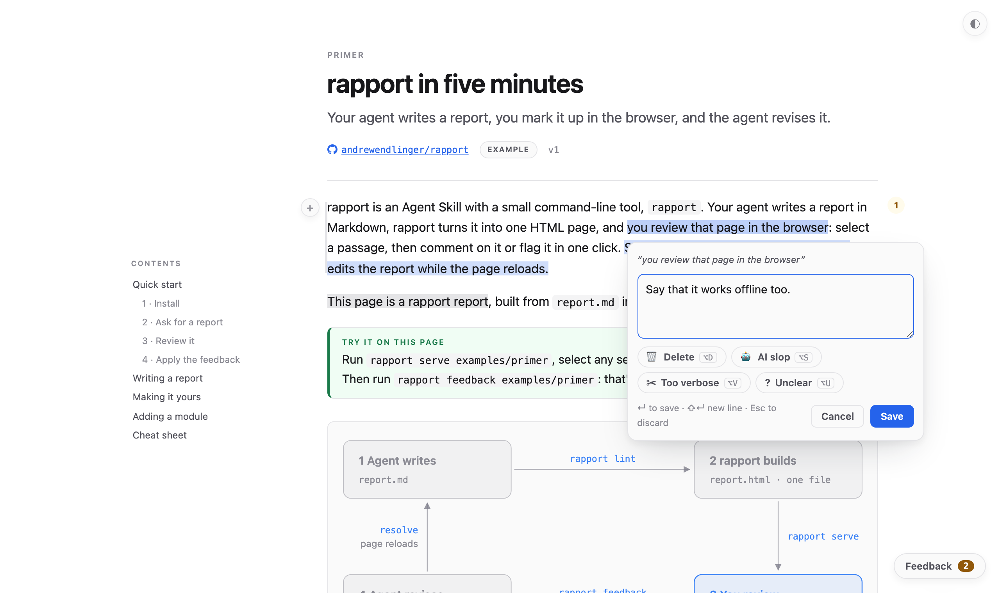

# rapport

**Your agent writes the report. You mark it up in the browser. The agent revises it.**

rapport is an Agent Skill with a small command-line tool. Your agent writes a report in Markdown, and rapport turns it into one self-contained HTML page. You review that page like a document: select a passage, then type a comment or flag it in one click (**Delete**, **AI slop**, **Too verbose**, **Unclear**, or actions you define). Then say *"apply the feedback"*: the agent gets every comment with its exact place in the source, edits the report, and the page reloads.

<picture>
  <source media="(prefers-color-scheme: dark)" srcset="docs/review-dark.png">
  
</picture>

It works in any harness that supports Agent Skills: Claude Code, Codex, pi and others.

## Quick start

**1. Install.** You need Python 3.11 or later and [uv](https://docs.astral.sh/uv/).

```sh
git clone https://github.com/andrewendlinger/rapport ~/code/rapport
~/code/rapport/install.sh --bin
```

**2. Read the primer.** [`examples/primer`](examples/primer) is a rapport report about rapport: a five-minute tutorial. Open its `report.html`, or serve it to try the review loop yourself:

```sh
rapport serve ~/code/rapport/examples/primer     # select any sentence and comment
rapport feedback ~/code/rapport/examples/primer  # what your agent reads
```

**3. Ask your agent for a report**, for example *"write up the cache regression as a rapport report"*. It writes the report, starts the review server and gives you the link. Review it, then say *"apply the feedback"*.

## How it works

1. **The agent writes** `report.md`: Markdown plus modules such as callouts, collapsible sections, side-by-side comparisons and badges. `rapport brief` tells it your writing rules and which modules exist.
2. **rapport builds** `report.html`, one file with images and fonts inside: no CDN, works offline, safe to send around.
3. **You review** in the browser. Everything saves as you go, and the page reloads when the report changes, but never while you're typing.
4. **The agent revises.** `rapport feedback` lists each comment with its current line numbers and what the action asks for. The agent makes one edit per comment and resolves it with a note, which you see in the page.

## Make it yours

Everything is set in TOML files that stack: your user config, a `rapport.toml` in your project, the front matter of one report. The nearest wins.

```toml
# rapport.toml in your repo
[theme]
name = "paper"                   # or default (minimal) or classic

[theme.tokens]                   # colours, fonts and sizes for every module
accent = "#0B6E4F"

[writing]                        # house style: the agent reads it, `rapport lint` checks it
audience = "the on-call team"
rules = ["Times in UTC"]

[[modules.feedback.actions]]     # a new button for the reader, an instruction for the agent
id = "cite"
label = "Needs source"
icon = "📎"
instruction = "Add a source or a link that supports this claim."
```

- **Look:** the default theme is minimal: system fonts, a white page, one accent colour, and a dark mode. `classic` and `paper` are built in too. Adjust any theme's tokens, then add your own CSS, which always wins over rapport's. A logo and icons go in the header and footer, as in the primer's [`rapport.toml`](examples/primer/rapport.toml). See [Styling](references/config.md#styling).
- **Modules:** every part of the page is a module, a folder with a template. `rapport modules new tabs --kind block` starts one, and a folder with a built-in's name replaces the built-in. See [references/modules.md](references/modules.md).
- **Where did a setting come from?** `rapport config show --origin`. All settings: `rapport config defaults`.

## Documentation

| | |
|---|---|
| [Primer](examples/primer) | the tutorial, as a rapport report |
| [Writing reports](references/authoring.md) | `report.md` syntax: front matter, modules, images |
| [Configuration](references/config.md) | config layers, styling, branding, recipes |
| [Modules](references/modules.md) | writing your own modules and themes |
| [SKILL.md](SKILL.md) | what the agent follows |

<details>
<summary><b>Install options</b></summary>

`install.sh` symlinks the folder to `~/.claude/skills/rapport` (Claude Code) and `~/.agents/skills/rapport` (pi, Codex and other Agent Skills harnesses). With `--bin` it puts `rapport` on your PATH, and it warms the dependency cache.

- `--target DIR` adds another harness folder, e.g. `~/.pi/agent/skills` for older pi versions.
- `--only DIR` links into DIR instead of the two default folders (repeatable).
- `--copy` copies instead of symlinking.
- `--venv` builds a `.venv` in the repo, for machines without uv or network access (or run `pip install -r requirements.txt`).
- `--dry-run` shows what would happen; `--uninstall` removes only what the script installed.

The CLI declares its dependencies (markdown-it-py, mdit-py-plugins, Jinja2, Pygments) inline, so uv installs them on first run. The reports themselves need nothing.

</details>

<details>
<summary><b>Reviewing: every control</b></summary>

- **Select text.** A window opens with the cursor in the comment box. Type and press Enter to save (Shift+Enter or ⌘↵ for a new line), or click an action to save it straight away. With text typed, actions work as tags. ⌘C still copies the passage. Before you type, ⌥ + the action's key picks an action. `[modules.feedback] autofocus` and `enter_saves` switch the first two off.
- **Prefer something quieter?** `[modules.feedback] on_select = "bar"` shows a slim icon bar instead, with single-key shortcuts and 💬 or `C` to comment.
- **Hover a block.** A **+** in the margin comments on the whole block: images, gifs, tables, code.
- **Existing feedback** stays highlighted in its action's colour (Delete is struck through), with counts in the margin. Click a highlight to edit or delete it.
- **The panel** (bottom right) lists everything with filters, takes comments on the whole report, and shows the agent's note on each resolved item.
- **Live reload** never interrupts a comment: you get an "updated" pill instead, and drafts survive reloads. Esc or Cancel discards a draft, with Undo.
- **After a round**, a thin bar in the right margin marks what changed: green for a new block, blue for an edited one, and a short red dash where something was removed. Hover one and the added words light up green, while a card shows the removed words, what you asked, and the agent's note on how it was addressed. Click it to list those items in the panel. The button next to **Feedback** hides or shows the bars.

A double-clicked `report.html` is the clean report: no feedback UI, no highlights, no change bars. `[modules.static-hint] enabled = true` adds a chip there with the command to serve it.

</details>

<details>
<summary><b>Repository layout</b></summary>

```
SKILL.md             what agents follow
bin/rapport          CLI wrapper (.venv → uv run → python3)
scripts/rapport.py   entry point with inline (PEP 723) dependencies
rapport_core/        config · schema · registry · parse · render · build · serve · feedback · lint · brief
config/schema.toml   core settings: types, defaults, docs, merge rules
modules/             every built-in module: layout, theme, element, block, inline, feature
presets/             named bundles of settings
references/          authoring.md · config.md · modules.md
examples/primer/     the tutorial report
docs/                README screenshots
tests/               pytest suite; tests/e2e drives a real browser
```

</details>

## Development

```sh
uv run --with pytest --with-requirements requirements.txt pytest tests
# browser tests (Playwright; needs a Chromium: `uvx playwright install chromium`, or set RP_CHROME)
uv run --with pytest --with playwright --with-requirements requirements.txt pytest tests/e2e
```
