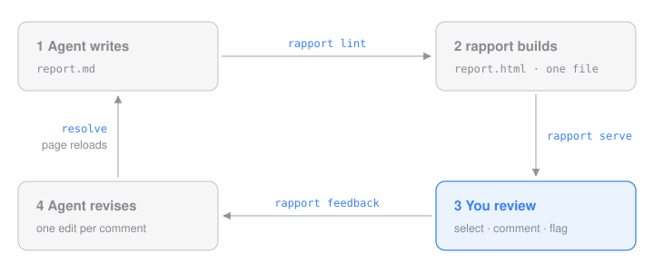

+++
title = "rapport in five minutes"
subtitle = "Your agent writes a report, you mark it up in the browser, and the agent revises it."
kicker = "Primer"
status = "example"
+++

rapport is an Agent Skill with a small command-line tool, `rapport`. Your agent writes a report in Markdown, rapport turns it into one HTML page, and you review that page in the browser: select a passage, then comment on it or flag it in one click. Say "apply the feedback" and the agent edits the report while the page reloads.

This page is a rapport report, built from `report.md` in this folder with the default theme.

::: callout Try it on this page {tone = "tip"}
Copy this folder somewhere (`cp -R examples/primer /tmp/primer`: serving rebuilds the report), run `rapport serve /tmp/primer`, select any sentence, type a comment and press Enter. Then run `rapport feedback /tmp/primer`: that's what your agent reads.
:::



Two ideas run through it:

- **Everything is a module.**\
  The header, the table of contents, each Markdown element, every `:::` block and the feedback window are folders under `modules/`. Add a folder to add a module, or to replace a built-in one.
- **Everything is configured in TOML.**\
  Theme, layout, writing rules and feedback actions live in config files that stack: your user config, your project, one report.

## Quick start

### 1 · Install

```sh
git clone https://github.com/andrewendlinger/rapport ~/code/rapport
~/code/rapport/install.sh --bin
```

This links the skill into Claude Code (`~/.claude/skills`) and other Agent Skills harnesses such as pi and Codex (`~/.agents/skills`), and puts `rapport` on your PATH. You need Python 3.11 or later and [uv](https://docs.astral.sh/uv/).

### 2 · Ask for a report

In your agent: *"Write up the cache regression as a rapport report."* It creates `reports/<name>/report.md`, writes it, starts the review server and gives you the link.

::: collapse What the agent runs
1. `rapport init reports/cache-regression` creates the folder.
2. `rapport brief` prints your writing rules and every module it can use.
3. It writes `report.md`, and `rapport lint` checks it: errors point at `report.md:LINE`.
4. `rapport serve --detach` starts the review server and prints the link.
:::

### 3 · Review it

- **Select text.** A comment window opens. Type and press Enter, or click an action: **Delete**, **AI slop**, **Too verbose** or **Unclear**.
- **Hover a block.** A **+** in the margin comments on a whole image, table or code block.
- **Open the panel** (bottom right) to see everything you've left, or to comment on the report as a whole.

Everything saves as you go. The page reloads when the report changes, but never while you're typing.

### 4 · Apply the feedback

Tell the agent: *"Apply the rapport feedback."* It reads your comments with `rapport feedback`, makes one edit per comment, and marks each one done with a note. The page reloads, and the panel lists the agent's notes under **Resolved**.

::: collapse What the agent sees
```text {wrap = true, hl = [5, 15, 18]}
rapport feedback — 2 open · report.md · v1
Apply each item to report.md, then: rapport feedback resolve <ids> --note "<what changed>"

FB-1 · Unclear · report.md:20-24
  do: Make this easier to understand: say it more simply, define terms on first use, and add a short concrete example if that helps.
  comment: Say what a module is before using the word.
  quote: "Everything is a module."
  │   20  - **Everything is a module.**\
  │   21    The header, the table of contents, each Markdown element, every `:::` block and the feedback window are folders under `modules/`. Add a folder to add a module, or to replace a built-in one.
  │   22  - **Everything is configured in TOML.**\
  │   23    Theme, layout, writing rules and feedback actions live in config files that stack: your user config, your project, one report.
  │   24  

FB-2 · AI slop · report.md:18
  do: Rewrite this in plain, concise, simply worded language that is easy to follow and understand. Not unnecessarily descriptive or verbose: to the point and human-friendly. Keep the facts.
  quote: "Two ideas run through it:"
  │   18  Two ideas run through it:
  learn: after fixing: distil the pattern into one short, general writing rule and ask the user whether to save it, and for all their reports or this project. Only on a yes: rapport writing add "<rule>" --scope user|project --approved
```

Each `do:` line is the action's instruction from config: change it and you change what the agent does. `learn` asks the agent to turn a fix into a writing rule, so the same complaint doesn't come back.
:::

## Writing a report

`report.md` is Markdown with a few additions. A block starts with `:::`, a name, an optional title and options in braces; inline modules look like `:badge[text]`.

::::: compare
:::: pane report.md
```markdown
::: callout Heads up {tone = "warning"}
Old entries miss once after deploy.
:::

Status: :badge[shipped]{tone = "ok"}
```
::::
:::: pane Result
::: callout Heads up {tone = "warning"}
Old entries miss once after deploy.
:::

Status: :badge[shipped]{tone = "ok"}
::::
:::::

| Module | Write | For |
|---|---|---|
| callout | `::: callout Title {tone = "tip"}` | a note, tip, warning or danger |
| collapse | `::: collapse Title` | detail most readers skip |
| compare | `::: compare` with a `::: pane` per column | before and after, side by side |
| badge | `:badge[text]{tone = "ok"}` | a status label in a sentence |
| code | ```` ```py {title = "app.py", hl = [2]} ```` | a caption and highlighted lines |
| image | `` | images and gifs, stored inside the page |

Everything else is plain Markdown: tables, footnotes, task lists. To see every module rendered, run `rapport gallery --out /tmp/gallery`.

## Making it yours

Settings are TOML and stack up, nearest first: the report's front matter, then every `rapport.toml` from the report folder up to your home folder, then your user config. The GitHub link under this page's title and its footer line come from the `rapport.toml` beside it:

```toml {title = "examples/primer/rapport.toml"}
[[modules.header.entries]]         # an icon and a link under the title
icon = "assets/github.svg"
text = "andrewendlinger/rapport"
href = "https://github.com/andrewendlinger/rapport"

[modules.footer]
show_date = false
text = "Built from report.md with rapport"
```

For a different look, pick a theme (`default`, `classic` or `paper`) and adjust its tokens: palette, fonts and sizes for every module, light and dark. Your own CSS comes last and wins over rapport's.

```toml
[theme]
name = "paper"
css = ["brand.css"]

[theme.tokens]
accent = "#0B6E4F"
body-size = "17px"

[theme.tokens.dark]
accent = "#6FD3A8"
```

Feedback actions are settings too. This adds a **Needs source** button for the reader, and tells the agent what to do when it's used:

```toml
[[modules.feedback.actions]]
id = "cite"
label = "Needs source"
icon = "📎"
instruction = "Add a source or a link that supports this claim."
```

House style goes in `[writing]`: who the reader is, the tone, words to avoid. The agent reads it in `rapport brief`, and `rapport lint` checks it.

::: callout Where did a setting come from? {tone = "note"}
`rapport config show --origin` prints every value with the file that set it. `rapport config paths` lists the files it reads.
:::

::: collapse All config layers, nearest wins
| Layer | Where |
|---|---|
| command line | `--set key=value` |
| front matter | the `+++` block at the top of `report.md` |
| project | every `rapport.toml` from the report folder up to your home folder |
| learned rules | added by the agent when you agree to save a rule |
| user | `~/.config/rapport/config.toml`, or wherever `RAPPORT_CONFIG` points |
| preset | a named bundle of settings |
| defaults | built into rapport and each module |

Most settings replace what's below them. Writing rules add up, and feedback actions merge by `id`, so you can change one field of one action.
:::

## Adding a module

```sh
rapport modules new timeline --kind block --scope project
rapport modules check timeline
```

A module is a folder: `module.toml` for its options, `template.html` for its markup, and optionally `style.css`, `script.js` and an `example.md`. There's no registration. Once `modules check` passes, `::: timeline` works and your agent finds it in `rapport brief`. To change a built-in, `rapport modules new callout` makes a thin override: copy in only the files you change, and the rest keeps getting rapport's fixes. A module can also keep state while the report is served, like a sign-off button or a poll: add `--server`.

::: collapse Module kinds
| Kind | What it is | How it's used |
|---|---|---|
| block | a `:::` block | `::: name Title {options}` … `:::` |
| inline | an inline label or widget | `:name[text]{options}` |
| element | how a Markdown element renders | automatic; replace one by name |
| layout | the page shell, header, contents, footer | `[layout] top`, `side`, `bottom` |
| theme | colours, fonts and base typography | `[theme] name = "…"` |
| feature | page behaviour: feedback, live reload, dark mode | on unless `enabled = false` |
:::

## Cheat sheet

| Command | What it does |
|---|---|
| `rapport init <dir>` | start a report |
| `rapport brief` | writing rules and modules, for the agent |
| `rapport lint` | build, and check errors and writing rules |
| `rapport serve` | serve with feedback and live reload; `--detach`, `--stop` |
| `rapport feedback` | open feedback; `resolve`, `add`, `reopen` |
| `rapport config show --origin` | every setting and where it came from |
| `rapport modules new <name>` | start your own module; `check`, `list`, `info` |
| `rapport gallery` | every module, rendered |

Next steps:

- [x] Read the primer
- [ ] Install rapport
- [ ] Ask your agent for a first report
